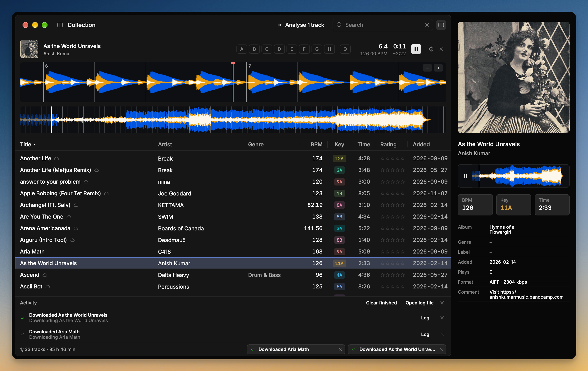

# Sleeve

A fast, good-looking app for your rekordbox library. Browse your tracks, analyse them, set hot cues and put playlists on a USB stick.



<p align="center">
  <a href="https://github.com/alii/sleeve/releases/latest/download/Sleeve.dmg"></a>
  &nbsp;
  <a href="https://github.com/alii/sleeve/releases/latest/download/Sleeve-windows.zip"></a>
</p>

## Get it

On a Mac, open the download and drag Sleeve into Applications. On Windows, unzip it and open Sleeve.exe. If Windows says it protected your PC, click **More info**, then **Run anyway**.

There's a new version every time the code changes. See [all releases](https://github.com/alii/sleeve/releases).

### Build it yourself

1. Install Rust from [rustup.rs](https://rustup.rs).
2. Get Sleeve and open it:
   ```sh
   git clone https://github.com/alii/sleeve
   cd sleeve
   cargo run --release
   ```

## Good to know

- To add songs, drag them or their folders from Finder onto Sleeve. Drop them on a playlist to add them there too. Sleeve analyses them straight away.
- To put a playlist on a USB stick, right-click it.
- Sleeve backs up your library before it changes anything.
- Close rekordbox first. Sleeve won't change your library while rekordbox is open.
- Songs stored in iCloud download when you play them.

## Licence

GPL-2.0-or-later. Built with [Rune](https://github.com/anomalyco/rune) and the [rbxport](https://github.com/chrisle/rbxport) crates.
