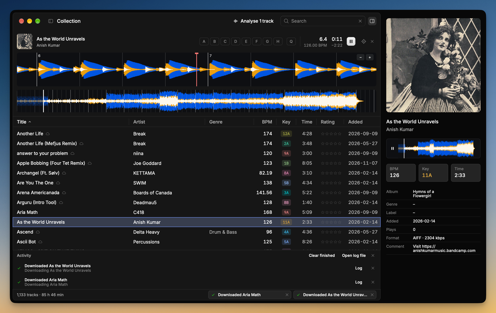

# Sleeve

A fast, good-looking app for your rekordbox library. Browse your tracks, analyse them, set hot cues and put playlists on a USB stick.



## Get it

Sleeve runs on a Mac. There's no download yet, so you build it yourself. It takes about five minutes.

1. Open Terminal.
2. Install Rust, then open a new Terminal window:
   ```sh
   curl --proto '=https' --tlsv1.2 -sSf https://sh.rustup.rs | sh
   ```
3. Get Sleeve and open it:
   ```sh
   git clone https://github.com/alii/sleeve
   cd sleeve
   cargo run --release
   ```

The first time takes a few minutes. If your Mac asks to install developer tools, say yes, then run step 3 again.

To open it again later, run `cd sleeve && cargo run --release`.

## Good to know

- Sleeve backs up your library before it changes anything.
- Close rekordbox first. Sleeve won't change your library while rekordbox is open.
- Songs stored in iCloud download when you play them.

## Licence

GPL-2.0-or-later. Built with [Rune](https://github.com/anomalyco/rune) and the [rbxport](https://github.com/chrisle/rbxport) crates.
